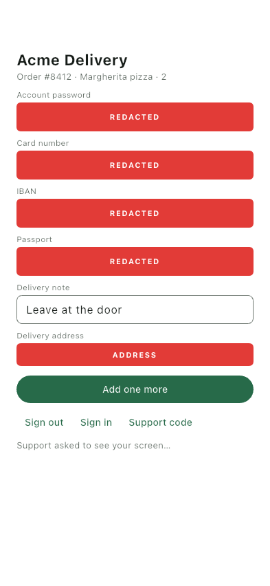
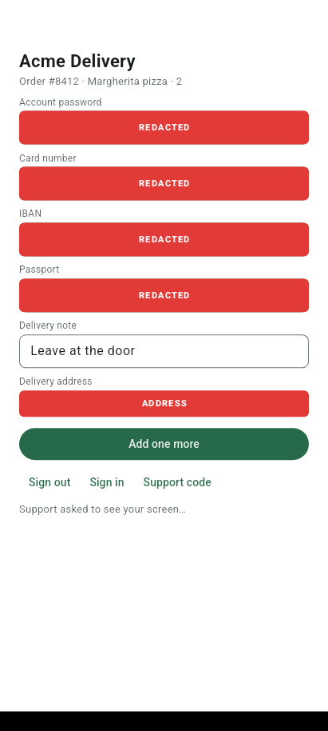

# Snaply Agent — Flutter example

A runnable Flutter app with Snaply Agent inside, through the
[`snaply_agent`](https://github.com/Mobile-LLC/SnaplyAgent-SDK-Flutter) package.

The whole integration is in [`lib/main.dart`](lib/main.dart): `Snaply.on` and `Snaply.configure`, and
`SnaplyRedact` around what must never leave the phone. There is no Snaply code in the `ios` or
`android` folders.

## Run it

1. Replace the two placeholder keys at the top of `lib/main.dart`:

   ```
   snap_live_REPLACE_WITH_YOUR_IOS_KEY
   snap_live_REPLACE_WITH_YOUR_ANDROID_KEY
   ```

   Get yours from the Snaply console → **Products → your product → API key**. An iOS product and
   an Android product each have their own key.

2. Add the app's identifier to each product's allowed list, or registration is refused. This
   example uses `com.example.snaplyexample.flutter` on both platforms.
3. `flutter run`.
4. Open the console, find the device, and request a screenshot. The consent prompt appears on the
   phone; nothing is captured until it is allowed.

## Adding Snaply to your own Flutter app

```yaml
dependencies:
  snaply_agent:
    git: https://github.com/Mobile-LLC/SnaplyAgent-SDK-Flutter
```

```dart
import 'package:snaply_agent/snaply_agent.dart';

await Snaply.configure(key: 'snap_live_…');
```

On iOS raise the Runner target's deployment target to 15 (Flutter's template says 13). Nothing else
is needed on either platform — no render mode, no `AppDelegate` or `MainActivity` code.

## What the screen shows

| In `lib/main.dart` | In the capture |
|---|---|
| A password field (`obscureText: true`) | Hidden on its own |
| `SnaplyRedact(child: …)` around the card number | Hidden |
| `SnaplyRedact(label: 'ADDRESS', …)` around a `Text` | Hidden, with its own caption |
| `Semantics(identifier: 'ibanField', …)` | Hidden once the dashboard has a rule by identifier `ibanField` |
| A field labelled "Passport number" | Hidden once the dashboard has a rule by text `passport` |
| The delivery note | Captured as it is — nothing marks it |

The box is painted **on the device, before the image is encoded**, and a hidden field takes neither
a tap nor text from an agent with remote control.

The buttons under the form call `Snaply.reset()`, `Snaply.identify(…)` and
`Snaply.showSupportCode()`; the line below them is fed by the callbacks.

What the agent received — iOS and Android (Flutter's default render mode, a release build):

| iOS | Android |
|---|---|
|  |  |

What was measured, and what was not, is in the
[package's README](https://github.com/Mobile-LLC/SnaplyAgent-SDK-Flutter#what-was-measured).

## Pointing the app at another backend

```
flutter run --dart-define=SNAPLY_KEY=snap_live_… --dart-define=SNAPLY_HOST=http://10.0.2.2:5100
```

Plain `http` is accepted for the machine's own loopback only; the debug manifest and `Info.plist`
allow exactly that (`localhost` on the iOS simulator, `10.0.2.2` on the Android emulator).

## Docs

<https://snaplyagent.com/docs>
